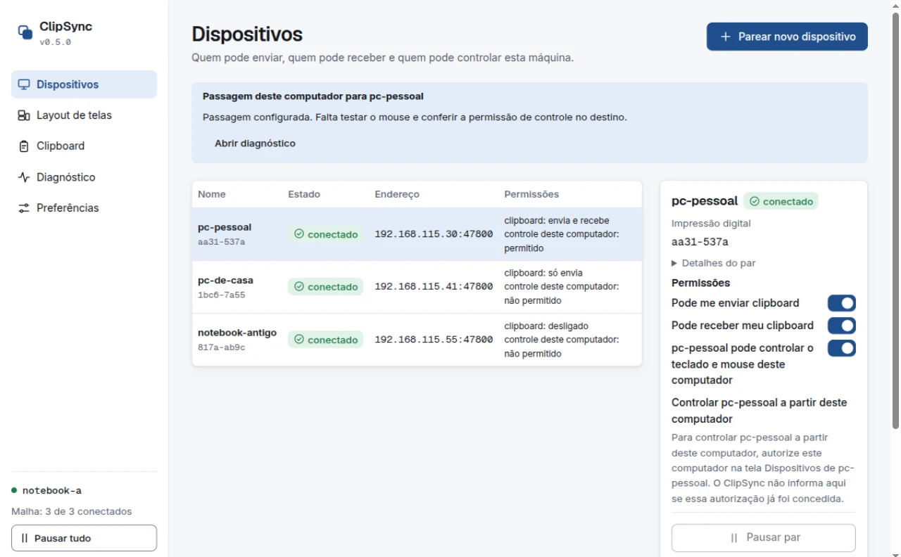
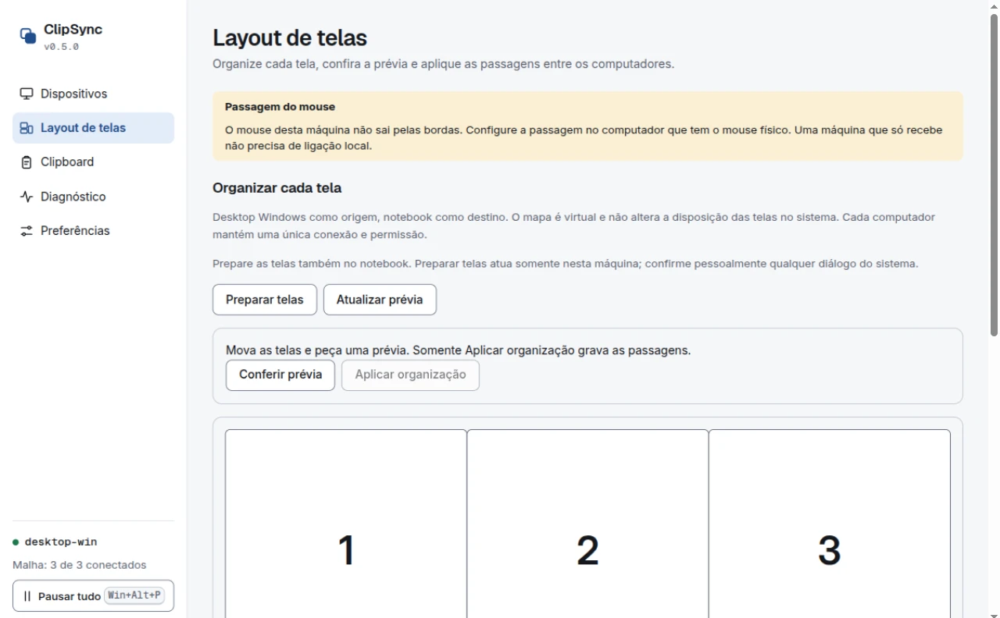

# ClipSync

Compartilhe teclado, mouse e área de transferência de texto entre computadores Linux (GNOME Wayland) e Windows, num app só e sem servidor central. Cada módulo é opcional.

**Estado:** a v0.5.3 está publicada no GitHub desde 13/11/2026. O PC devolve o mouse e o teclado sozinho quando o notebook para de responder e avisa que o controle voltou. Ela também reencontra o outro computador pelo nome quando o IP muda, recria o controle do mouse no notebook depois de suspender ou bloquear a tela e traz o log verificável da travessia. Teclado e mouse por posição seguem experimentais, e o percurso físico A ↔ notebook ↔ B ainda não tem aceite. O clipboard pode transmitir conteúdo marcado como sensível: use `clipsync pause` ao copiar senhas. Detalhes em [limitações](docs/limitacoes.md).

## Instalar

Baixe a [v0.5.3](https://github.com/devkappiushon/clipsync/releases/tag/v0.5.3). Cada release traz seis pacotes e o `SHA256SUMS` para conferir os arquivos.

- Linux, app: `clipsync-app-v0.5.3-linux-x86_64.AppImage` ou `clipsync-app-v0.5.3-linux-amd64.deb`.
- Windows, app: `clipsync-app-v0.5.3-windows-x86_64-setup.exe` ou `clipsync-app-v0.5.3-windows-x86_64.msi`.
- Linha de comando: `clipsync-v0.5.3-linux-x86_64.tar.gz` ou `clipsync-v0.5.3-windows-x86_64.zip`. Os pacotes do app não instalam a CLI; baixe também se quiser `clipsync status`, `diagnose` ou os comandos de teste.

Confira antes de executar:

```sh
# Linux
sha256sum -c SHA256SUMS --ignore-missing
```

```powershell
# Windows (PowerShell): compare com a linha do pacote em SHA256SUMS
Get-FileHash .\clipsync-app-v0.5.3-windows-x86_64-setup.exe -Algorithm SHA256
```

O `--ignore-missing` confere só os arquivos presentes na pasta; baixe os pacotes que quiser verificar. O instalador do AppImage executa o arquivo para extrair o ícone, então confira o hash antes de rodá-lo.

No primeiro uso:

1. Instale a mesma versão nas duas máquinas.
2. Pareie em **Dispositivos** e confirme o código de 6 dígitos nas duas. No computador que receberá o controle, em **Permissões iniciais**, ative “{nome do par} pode controlar o teclado e mouse deste computador”, confirme **Conceder controle** e clique em **Concluir**.
3. Em **Layout de telas**, use **Preparar telas** nas duas máquinas e confirme pessoalmente eventual diálogo do sistema. Depois, no desktop Windows com o mouse físico, posicione as telas na seção **Organizar cada tela**, use **Conferir prévia** e acione **Aplicar organização**.

O passo a passo de AppImage, `.deb`, SmartScreen e WebView2 está em [instalar](docs/instalar.md); a configuração da passagem e o roteiro de teste ficam em [uso](docs/uso.md).

## Telas

Capturas do simulador da interface na v0.5.0, com dados fictícios. Tema claro aqui; o escuro e as demais telas estão em [docs/telas/v0.5.0](docs/telas/v0.5.0/).





## Por que usar

Teclado e mouse formam o módulo de entrada; o clipboard de texto é o outro. Dá para usar só um ou os dois. A escolha fica em **Preferências > Módulos** e preserva identidade e pareamentos.

O ClipSync foi criado para substituir o Input Leap. Em vez de escolher bordas uma a uma, você posiciona as telas e liga a passagem na posição desejada. Com dois monitores no desktop Windows e um notebook no meio, o mapa por monitor permite montar A ↔ notebook ↔ B sem transformar cada trecho em uma ligação solta. A e B continuam no mesmo computador e na mesma conexão. O mapa não muda a disposição nativa das telas nem concede permissões.

O que está disponível hoje:

- Malha QUIC e pareamento nas duas plataformas.
- Clipboard de texto nas duas plataformas, só texto.
- Módulo de entrada (teclado e mouse por posição), experimental no GNOME Wayland e no Windows.

A substituição do Input Leap ainda depende da validação física da entrada entre máquinas reais. Até lá, os dois não devem capturar ao mesmo tempo; no Linux, `clipsync diagnose` detecta Input Leap e Barrier ativos e orienta a pausa.

## Referência

- [Instalar](docs/instalar.md): pacotes, AppImage, `.deb`, SmartScreen, WebView2 e linha de comando.
- [Uso](docs/uso.md): módulos, pareamento, layout de telas, roteiro de 10 minutos e Input Leap.
- [Limitações](docs/limitacoes.md): avisos do Windows, clipboard no Linux, plataformas e o que falta validar.
- [Desenvolvimento](docs/desenvolvimento.md): requisitos, comandos Rust, testes da interface e CI.
- [Monitores independentes](docs/monitores-independentes.md): o mapa A ↔ notebook ↔ B e a recuperação do layout.
- [Contrato](docs/contrato.md): decisões vinculantes, incluindo a S10 no §16.
- [Segurança](docs/seguranca.md) e [vereditos](docs/verdicts.md): revisões por rodada.
- [AGENTS.md](AGENTS.md): regras de trabalho e invariantes do repositório.
- [Interface](crates/clipsync-app/ui/README.md): telas, cenários do simulador e testes.
- [Notas da v0.5.3](docs/releases/v0.5.3.md) e [changelog](CHANGELOG.md): o que mudou e o histórico de versões.

## Licença

Todos os direitos reservados, até o autor escolher uma licença aberta. Sem licença, o código pode ser lido, mas não pode ser copiado, alterado nem redistribuído.

feito por montesouza.dev
